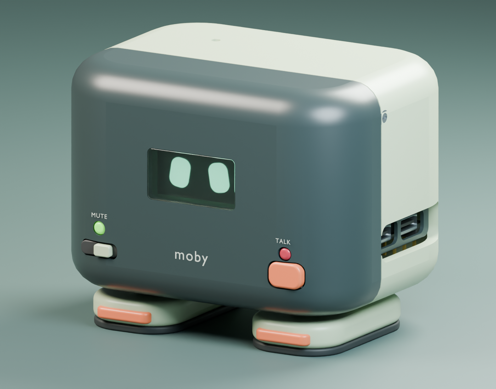

# Moby Mini 3D models

Moby Mini is a compact ESP32-S3 desktop robot with one enclosure and two short feet. It measures **74.8 × 56.9 × 60.8 mm** without a cable. The OLED and controls face forward, the microphone opens at the top, and the speaker fires through the rear grille.



## Models and wiring

| File | Contents |
| --- | --- |
| [Assembled Blender model](moby-mini-assembled.blend) | Installed enclosure, feet, components, fasteners and wiring. |
| [Exploded Blender model](moby-mini-exploded.blend) · [Preview](moby-mini-exploded.png) | Separated parts and fasteners. The displayed wires stretch with the parts so their endpoints stay visible. |
| [Wiring source](wiring.csv) · [Contact coordinates](moby-mini-netlist.csv) | 22 electrical nets and 69 connected contacts. Each Blender wire carries `Net`, `From` and `To` properties. |
| [Components and sources](moby-mini-components.md) | Part selection, reference drawings, and assembly notes in Uzbek. |

## Edit or rebuild

Open either `.blend` in Blender 5.2. The scenes are editable and use millimeters. To regenerate both scenes and the coordinate CSV from a checkout, run the following command in the repository root. The generator uses Blender's bundled Python and the geometry in `cad/`.

```sh
blender --background --factory-startup --python-exit-code 1 --python build_moby_mini.py
```

Press **F12** in either scene to render its preview. The mesh geometry is self-contained in each `.blend` file.

## Prototype status

The layout includes the optional MAX98357A audio board and SG90 servo. The two feet fasten to internal supports, and the servo and opposing pivot are intended to tilt the enclosure. The electrical graph was checked in Blender. Physical assembly, manufacturing tolerances, servo travel, cable fit and USB power capacity need validation on a prototype. Use the wiring table for connectivity and measure wire lengths during assembly.

## Licence and contributions

The Moby design, generator, wiring and documentation use [CERN-OHL-P-2.0](LICENSE). Embedded and bundled third-party geometry retains the licences and credits in [THIRD_PARTY.md](THIRD_PARTY.md). See [CONTRIBUTING.md](CONTRIBUTING.md) for changes to geometry, wiring or imported components.

## O‘zbekcha

Moby Mini bitta bosh-qobiq va ikkita kalta oyoqli stol robotidir. [Yig‘ilgan](moby-mini-assembled.blend) va [sochilgan](moby-mini-exploded.blend) Blender sahnalarida elektronika, mahkamlagichlar va simlar bor. [Komponentlar va yig‘ish tafsilotlari](moby-mini-components.md) hamda [kontaktlar jadvali](moby-mini-netlist.csv) repoga kiritilgan. Fizik prototipda detallar mosligi, kabel va servo yurishi tekshiriladi.
